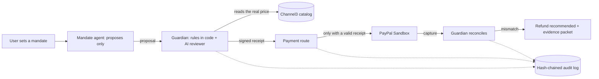

# Mandate & Guardian: Trust Layer for AI Shopping Agents

> The agent that spends is not the one that watches.

Built for the [PayPal AI Hackathon 2026](https://paypalaihackathon.devpost.com/). **Sandbox prototype.**

The idea: a buyer agent (**Mandate**) can only *propose* purchases inside the rules a user sets.
An independent auditor (**Guardian**) approves, blocks or asks a human *before* any PayPal payment,
then reconciles what was charged and recommends a refund when something doesn't match.

## Try it in two minutes (no keys, no PayPal login)

1. Open the demo (or run `npm ci && npm run build && npm start`, then [localhost:3000](http://localhost:3000)).
2. Press **Run a guided demo**: it creates an example mandate and runs the buyer agent. The Guardian
   reviews the proposal against the rules and signs its approval. Without keys the products come from a
   labeled offline demo catalog.
3. Open the row and the **Receipt and trail** tab: the signed receipt (press **Verify signature**) and the
   hash-chained timeline.
4. Press **Red team** to throw 12 hostile proposals and 8 attacks on the evidence at the Guardian (forged
   prices, prompt injection, salami slicing, an edited receipt, a rewritten audit log) and see what it did
   with each. Open **Audit log** for the chained events.
5. To pay, you need a PayPal Sandbox buyer account and the server's demo key; see
   [docs/PAYPAL-TESTING.md](docs/PAYPAL-TESTING.md).



## What works today

- **Guardian rules (deterministic code, no AI):** currency, per-purchase cap, monthly cap, allowed
  categories, delivery deadline and "price matches the live listing". Any failed rule blocks the
  proposal; a passing proposal above the mandate's human-confirmation threshold asks a person.
  See `src/guardian/rules.ts`.
- **AI reviewer:** `src/guardian/guardian.ts` accepts an optional reviewer that can only make a
  verdict stricter (approve -> ask_human), never override a block. `src/guardian/ai-reviewer.ts`
  implements it on top of a Gemini REST client (`src/guardian/llm.ts`); it is enabled only when
  `AI_API_KEY` and `AI_MODEL` are set. If the model fails or answers badly, the purchase goes to a
  human. The prompt includes the current date (America/Guayaquil). It is unit-tested with a fake
  model, and `npm run smoke:ai` runs four cases against the real model in `.env` (checked by the
  author on Nov 3 with `gemini-3.1-flash-lite`, three runs with the same results; model answers can vary). Without those variables,
  explanations are deterministic text.
- **Reconciliation:** after a capture, `POST /api/proposals/:id/reconcile` reads the capture from PayPal
  (amount and currency) and compares it with the approved price. An optional demo overcharge
  (`ENABLE_DEMO_SCENARIO=true`) is labeled as simulated and never changes the real captured amount.
- **PayPal Sandbox payments** (`src/paypal/`, plain `fetch`, sandbox host only): create order with
  buyer approval link and return/cancel pages, authorize, capture, void, full refund, order and
  capture lookup, Transaction Search and disputes read methods. Payment routes check the proposal
  status, re-run the Guardian rules before authorizing or capturing, use deterministic idempotency
  keys and lock each proposal while an operation runs. **Plan A is the main flow.** Authorize
  the buyer-approved order, then capture or void it. Plan B remains the tested direct-capture
  fallback. Human confirmation and payment routes require `DEMO_API_KEY`.
- **Buyer agent, Mandate** (`src/mandate/agent.ts`): turns the mandate goal into a search query,
  searches the catalog under the per-purchase cap, keeps in-stock items in the mandate currency and
  proposes one. With `AI_API_KEY`/`AI_MODEL` set, the same Gemini model writes the query and picks
  the best fit with a short reason; otherwise it takes the most relevant result. Listings are passed
  to the model as untrusted data. **Mandate cannot pay:** it never imports the PayPal client (a unit
  test enforces this) and never fills `listedPrice`.
- **Product search with [Channel3](https://trychannel3.com)** (`src/channel3/client.ts`, plain
  `fetch`): `POST /v1/search` with a price filter and `GET /v1/products/{id}`. Used when
  `CHANNEL3_API_KEY` is set. Without a key the app uses a small offline catalog and reports
  `"source": "demo"` everywhere, so demo data is never shown as live. The client is unit-tested with a
  mocked HTTP layer; `npm run smoke:channel3` calls the live API. Checked by the author on Nov 3
  against the live API: search and product re-read return title, offers with `price.price`,
  `availability` and the merchant `domain` (no separate seller name), and a full `/shop` run proposed
  a real product that the Guardian approved.
- **Server-side price verification** (`src/guardian/listing.ts`): the server reads the product from
  the catalog by `productId` and sets `listedPrice` itself; a `listedPrice` sent by the client is always
  discarded. The `price_verified` and `price_matches_listing` rules then compare the proposed price with
  the catalog. A proposal with no `productId`, an unknown product, a currency mismatch or a catalog
  that cannot be reached is **blocked** (it fails closed). Unit and endpoint tests cover each case;
  against the demo catalog only, not repeated against live Channel3 after this change.
- **Signed approval receipts** (`src/guardian/receipt.ts`): every approval is signed with Ed25519 (a
  human confirmation produces a second receipt). `POST /api/proposals/:id/pay` refuses to create a
  PayPal order without a valid receipt, and refuses a proposal whose price, product or mandate changed
  after the approval. This enforces that the Guardian step happened and that the approved fields were
  not edited; the key lives in the same server process, so it is not a separate trust domain. Set
  `GUARDIAN_SIGNING_KEY` to keep receipts valid across restarts; without it a new key is generated at
  start. Verify a receipt with `POST /api/receipts/verify` or the dashboard.
- **Hash-chained audit log** (`src/audit/chain.ts`): every proposal review and every status change
  (order, authorization, capture, void, reconciliation, refund) is appended with the hash of the
  previous event. `GET /api/audit-log/verify` reports whether the chain is intact and where it breaks.
  It detects tampering; it lives in memory like the rest of the store and is not durable.
- **Red team** (`src/redteam.ts`, `POST /api/redteam/run`, the "Red team" button): 12 hostile scenarios
  (over the cap, forged catalog price, self-reported price, unknown product, currency swap, wrong
  category, late delivery, salami slicing across the monthly cap, two prompt injections, the
  human-confirmation threshold, and a control that must be approved) go through the same Guardian code
  the API uses, on an isolated store and an offline test catalog. Real records are never touched. With
  an AI model configured, the two injection scenarios can also be shown to the reviewer. Covered by
  tests, including a reviewer that tries to approve everything. Eight more attacks target the evidence
  itself: editing a signed receipt, lowering the price after approval, paying with no receipt, a receipt
  signed by another key, loosening the mandate afterwards, and rewriting, deleting or reordering events in
  the audit log. Each is caught by the same checks the payment route and the log verifier use, and the
  window says what was caught (for example "Chain broken at event #2").
- **Alternatives for a blocked purchase** (`src/guardian/alternatives.ts`): when the Guardian blocks a
  proposal, the detail window can search the same Channel3 catalog for in-stock products that fit the
  mandate (under the per-purchase cap and under what is left of the month, in the mandate currency), with
  photos. "Propose this instead" builds a new proposal from catalog data only and sends it through the
  Guardian again, so the replacement gets the same rules, price check and signed receipt as any purchase.
  Routes: `GET /api/proposals/:id/alternatives` and `POST /api/proposals/:id/swap` (blocked proposals only).
- **Audit log table** (AG Grid): the "Audit log" window lists every chained event with its hash and what it
  links to, with filters, search, CSV export, a live total row and a flash on new events. It uses AG Grid
  Community only.
- **Guardian analytics** (AG Studio, the "Analytics" button): a self-serve report over the live audit data
  (proposals, rule findings and the audit events), opened with a ready dashboard of tiles, charts and a
  grid. Users drag in their own widgets, and an AI assistant (Gemini) answers questions and builds widgets
  from the chat. It is a custom lead agent, "Guardian Analyst", that keeps Studio's own tools and can hand
  work to Studio's data, page, planning and widget agents and to a second custom agent, "Anomaly Watch".
  It has one tool of its own, `explainGuardianDecision`, which reads the Guardian's written reasoning
  (blocked, why, and what would have let it pass). The assistant only reads dashboard data and arranges
  widgets in the browser; it cannot approve, pay or refund. Gemini is reached through
  `POST /api/ai/turn` (`src/ai-turn.ts`), so the key and model stay on the server, and the route needs the
  demo key and is rate limited. Without `AI_API_KEY` the report still works without the assistant.
  AG Studio is a commercial library: it runs without a licence key and shows an evaluation watermark.
  Set `VITE_AG_STUDIO` when building to remove it (AG Grid offers a free 45-day trial key).
- **Fix hints and evidence packet:** a failed rule says what would have to change for it to pass
  (deterministic text, not from a model). `GET /api/proposals/:id/evidence?format=md` (demo key)
  returns the decision, receipt, PayPal IDs, reconciliation and the hash-chained timeline for one
  proposal. It supports a dispute; it does not file one.
- **Second reading through PayPal's official SDK** (`src/paypal/sdk-reader.ts`): when it reconciles a
  capture, the Guardian reads it a second time with `@paypal/paypal-server-sdk` (a different code path
  from the app's own fetch client) and compares status, amount, currency and order. If the two readings
  disagree, the proposal goes to `alert` and the detail window and evidence packet say so. If the SDK
  cannot be reached, the app's own reading stands and the record says the second reading was not
  available. The reader only reads, and it is Sandbox only (it is not created for a production base URL).
  Set `PAYPAL_SDK_CROSSCHECK=false` to switch it off. The contract for this read (the operation, the fields
  that may be absent, what each error status means) is in [paypal-plan.md](paypal-plan.md), written with the
  APIMatic Context Plugin for PayPal. The code uses PayPal's registry-published `@paypal/paypal-server-sdk`
  rather than the plugin's own SDK, which is not on npm; the plan says why.
- **Rate limits:** per-IP limits on `/api/mandates/:id/shop`, `/api/mandates/parse`,
  `/api/proposals` and `/api/redteam/run`.
- **Natural-language mandates** (`src/mandate/parse-mandate.ts`, needs the AI model): turns a request
  such as "a gift for my mom, max $40, by Friday" into a mandate draft for the user to review. The
  model never invents a spending cap; missing caps come back as questions.
- **Dashboard** (`client/`, React + AG Grid, served by the API after `npm run build`): shows the audit
  records from `/api/records`, creates mandates, runs the buyer agent and drives the Plan A checkout
  (open the PayPal Sandbox checkout, verify the buyer approval and authorize, capture or void,
  reconcile, refund). It reads everything from the API; it has no sample data and no mock mode.
  The payment and human-confirmation buttons need the `DEMO_API_KEY`, which you type in Settings
  (masked, kept in the browser tab's session storage only).
- **REST API** (Express, in-memory store, data is lost on restart) with unit tests for the Guardian,
  AI reviewer, buyer agent, Channel3 and PayPal routes.

See the [PayPal Sandbox setup, demo run and Render instructions](docs/PAYPAL-TESTING.md).

## Verification status

| Scope | Evidence |
|---|---|
| Combined app | Automated tests exercise two complete Plan A rounds using mocked PayPal HTTP and the demo catalog. They verify approval, duplicate-order prevention, rejection of a blocked payment, capture, reconciliation, human-confirmed refund and separate void. |
| PayPal Sandbox | Edison verified the direct CLI Plan A and B flows and a separate buyer dispute. Transaction Search returned HTTP 403. The app uses the capture lookup for reconciliation. See [Sandbox results](docs/SANDBOX-RESULTS.md). |
| Channel3 and Gemini | Verified separately before integration, then together with PayPal Sandbox in the local dashboard run of November 4 (see below). The Render checkout run used the demo catalog and deterministic Guardian rules. |
| Local integrated run | November 4, 2026, one machine, live Channel3, Gemini and PayPal Sandbox, driven from the dashboard: order, buyer approval, authorize, capture, reconcile, human confirmation, simulated overcharge, full refund, and a voided authorization. Voiding released the buyer's hold: the Sandbox available balance rose by the voided amount. Details in [Sandbox results](docs/SANDBOX-RESULTS.md). |
| Render | Verified on November 4, 2026. The [public Render deployment](https://mandate-guardian-demo.onrender.com) completed two Plan A rounds against PayPal Sandbox. The buyer returned to the public HTTPS `/paypal/return` URL, and [`/api/health`](https://mandate-guardian-demo.onrender.com/api/health) reported `ok: true` and `paypalPlan: "A"`. |
| Second reading (PayPal SDK) | November 9, 2026, on the public Render deployment, one Plan A round with a Sandbox Personal buyer: a USD 17.99 order was approved by the buyer, authorized, captured and reconciled. Reconciliation reported "amounts match", and the second reading through `@paypal/paypal-server-sdk` read the same capture (USD 17.99, `COMPLETED`) and agreed. A simulated overcharge then raised the alert and the refund completed. |

Both Render rounds recorded `completed: true`. The Guardian blocked a USD 55.00
proposal because it exceeded the USD 40.00 cap and differed from the catalog price.
Each USD 24.00 capture matched the approved amount. A simulated USD 32.50 charge
triggered an alert, the refund of the original capture completed, and a separate
authorization was voided before capture. Retries reused the same order IDs.
The JSON evidence for run `ef0f89a6` is stored locally under `.local/edison-paypal/api/`.

Known issues: the Gemini reviewer can flag a valid Channel3 product as suspicious because its buy link
goes through `buy.trychannel3.com`; it only makes the verdict stricter, so the proposal waits for a human.
The dashboard's "Guardian verdict" column keeps the original verdict after a human approves.

The demo is single-user. Durable storage, individual authentication, webhooks and
automatic dispute submission are outside its current scope.

## Quick start

Requires Node.js 22.

```bash
git clone https://github.com/JoelVelasqueZz/mandate-guardian.git
cd mandate-guardian
npm ci
npm test
npm run typecheck
npm run build
npm start
```

Open [localhost:3000](http://localhost:3000). Without keys the app uses the labeled offline catalog.
For PayPal checkout, configure the seller and separate Personal Sandbox buyer
using the [testing guide](docs/PAYPAL-TESTING.md). Run `npm run verify:plan-a`
in a second terminal to produce two audit files.

## Configuration

Copy `.env.example` to `.env` and fill only what you need. Never commit `.env`.

| Variable | Needed for |
|---|---|
| `AI_API_KEY`, `AI_MODEL` | AI reviewer, buyer agent and natural-language mandates (Google AI Studio key). Empty: rules only. |
| `CHANNEL3_API_KEY` | Live product search. Empty: labeled offline demo catalog. |
| `VITE_AG_STUDIO` | Optional AG Studio licence key, read at **build time** (`npm run build`). Empty: the analytics window works and shows an evaluation watermark. |
| `PAYPAL_CLIENT_ID`, `PAYPAL_CLIENT_SECRET` | PayPal **Sandbox** app credentials. |
| `PAYPAL_PLAN`, `APP_BASE_URL` | Set Plan A. For local runs, set the app origin. Render provides the HTTPS origin when `APP_BASE_URL` is unset. |
| `DEMO_API_KEY` | **Required for human confirmation and payment routes.** Set it to a random string of your own; it is a shared demo access key, not a PayPal credential. Without it the payment routes answer 503. Clients send `Authorization: Bearer <DEMO_API_KEY>`. |
| `ENABLE_DEMO_SCENARIO` | Optional: `true` enables the labeled simulated overcharge. |
| `PAYPAL_SDK_CROSSCHECK` | Optional: `false` turns off the second reading through the PayPal SDK. |

Use `npm run smoke:paypal` for a direct Sandbox order or
`npm run verify:plan-a` for the integrated demo with its buyer approval and refund prompts.

To try the AI reviewer, set `AI_API_KEY` (Google AI Studio) and `AI_MODEL` in `.env` and run
`npm run smoke:ai`.

To search live products, set `CHANNEL3_API_KEY` and run
`npm run smoke:channel3 -- "birthday gift for mom" 40`.

Try the buyer agent without any keys (demo catalog):

```bash
curl -s -X POST localhost:3000/api/mandates -H "Content-Type: application/json" \
  -d '{"goal":"a birthday gift for my mom","maxPerPurchase":40,"maxMonthly":100}'
# then, with the returned id:
curl -s -X POST localhost:3000/api/mandates/<id>/shop -H "Content-Type: application/json" -d '{}'
```

For development, `npm run dev` runs the API and `npx vite` runs the dashboard on port 5173 with a
proxy to the API.

## API

"Demo key" means the route requires `Authorization: Bearer <DEMO_API_KEY>`. The other routes have no
authentication; this is a single-user demo API.

| Method | Path | Auth | What it does |
|---|---|---|---|
| GET | `/api/health` | none | Health, catalog source, AI status, selected PayPal plan and demo overcharge flag |
| GET | `/api/mandates` | none | List mandates for the dashboard |
| POST | `/api/mandates/parse` | none | Natural language to a mandate draft (needs the AI model) |
| POST | `/api/mandates` | none | Create the user's spending rules |
| POST | `/api/mandates/:id/shop` | none | Mandate searches the catalog and proposes; the Guardian reviews the proposal |
| POST | `/api/proposals` | none | Submit a purchase proposal; the Guardian reviews it |
| POST | `/api/proposals/:id/confirm` | demo key | A human confirms a proposal the Guardian flagged |
| GET | `/api/proposals/:id/alternatives` | none | Products from the catalog that fit the mandate (blocked proposals only) |
| POST | `/api/proposals/:id/swap` | none | Send one of those products back through the Guardian as a new proposal |
| POST | `/api/ai/turn` | demo key | One turn of the analytics assistant: the conversation in, Gemini's text and tool calls out. The model and key are the server's. |
| GET | `/api/guardian/public-key` | none | Public key that verifies the Guardian's receipts |
| GET | `/api/proposals/:id/receipt` | none | The Guardian's signed receipt for an approved proposal |
| POST | `/api/receipts/verify` | none | Check a receipt's signature |
| GET | `/api/audit-log`, `/api/audit-log/verify` | none | Hash-chained events and the integrity check |
| POST | `/api/redteam/run` | none | Run the hostile scenarios on an isolated copy of the Guardian |
| GET | `/api/proposals/:id/evidence` | demo key | Evidence packet (`?format=md` for Markdown) |
| GET | `/api/records` | none | Audit records with checkout URLs and return tokens omitted |
| POST | `/api/proposals/:id/pay` | demo key | Create the PayPal Sandbox order for an approved proposal; returns the buyer approval link |
| GET | `/api/proposals/:id/paypal` | demo key | Read the PayPal order, to check buyer approval |
| POST | `/api/proposals/:id/authorize` | demo key | Plan A: authorize the buyer-approved order |
| POST | `/api/proposals/:id/capture` | demo key | Capture the authorization (Plan A) or the approved order (Plan B) |
| POST | `/api/proposals/:id/void` | demo key | Cancel an uncaptured authorization |
| POST | `/api/proposals/:id/reconcile` | demo key | Read the PayPal capture and compare amount and currency |
| POST | `/api/proposals/:id/demo-overcharge` | demo key | Labeled simulated overcharge (only if `ENABLE_DEMO_SCENARIO=true`) |
| POST | `/api/proposals/:id/refund` | demo key | Full refund; the body must be `{"confirm": true}` |
| GET | `/api/paypal/transactions` | demo key | Transaction Search (returned 403 in the team's sandbox) |
| GET | `/paypal/return`, `/paypal/cancel` | none | Pages PayPal redirects the buyer to; they never capture a payment |

Payment details and the request contract are in [docs/PAYPAL-TESTING.md](docs/PAYPAL-TESTING.md).

## Security notes

- A proposal can only be paid with a valid Guardian receipt (see above). Anything edited after approval is refused.
- PayPal **Sandbox** only. Never commit `.env`; it is git-ignored.
- Spending caps live in deterministic code and are not delegated to a model.
- Use only synthetic mandates and Sandbox data in the shared demo. The demo key gates
  confirmation and payment. Public audit rows omit checkout links and return tokens.

## License

MIT
